# Classificador de Mensagens de Clientes com IA

Solução para o **Desafio Técnico KODIE: IA e Automação** (caso **4.1, Classificação de Mensagens**).
Uma API em **FastAPI** usa o **Google Gemini** para ler cada mensagem de cliente e devolver um **JSON estruturado**
(categoria, setor, urgência, sentimento, resumo e resposta sugerida). Um fluxo no **n8n** recebe a mensagem,
chama a API e **encaminha o resultado por e-mail (SMTP)** ao responsável.

```
Cliente ──POST──▶ n8n Webhook ──▶ Edit Fields ──▶ HTTP Request ──▶ API FastAPI ──▶ Gemini
                                                                      │
                     Respond to Webhook ◀── Send Email (SMTP) ◀── Edit Fields (monta e-mail)
```

---

## 1. Apresentação da ideia

Em pequenas empresas é comum que uma única pessoa leia todas as mensagens recebidas, descubra do que se trata e
repasse para o setor certo. É um trabalho repetitivo, lento e sujeito a erros: uma reclamação urgente pode ficar
esquecida no meio de dúvidas simples. A ideia surgiu do próprio cenário do desafio: usar a IA para **interpretar**
a mensagem e a automação para **agir** sobre a interpretação, sem intervenção manual.

## 2. Problema escolhido

**4.1: Classificação de Mensagens.** A empresa recebe dúvidas, reclamações e solicitações misturadas e não tem um
processo para identificar o assunto e o setor responsável. A solução precisa:

- identificar o **tipo** da mensagem (dúvida, reclamação ou solicitação);
- indicar o **setor** que deve tratá-la e a **urgência**;
- entregar a informação já organizada a quem vai responder.

## 3. Solução proposta

1. A mensagem do cliente chega ao **Webhook do n8n** (pode vir de um formulário do site, chatbot, etc.).
2. O n8n normaliza os dados e chama a **API FastAPI** (`POST /classificar`).
3. A API envia a mensagem ao **Gemini** com um **prompt estruturado** (regras de cada categoria, exemplos e formato
   de saída) e com `responseSchema`, o que força a IA a responder **somente em JSON** com valores permitidos.
4. A API **valida** a resposta com Pydantic (enums, tipos, faixa de confiança). Se a IA sair do formato, a API
   devolve erro 502 em vez de propagar dados inválidos.
5. O n8n monta um e-mail com assunto no formato `[RECLAMACAO · ALTA] logistica – João Silva` e o corpo com resumo,
   palavras-chave, mensagem original e **rascunho de resposta**, e envia por **SMTP** (conta de e-mail do domínio, hospedada em cPanel).
6. O webhook responde ao chamador com o JSON da classificação.

A IA, portanto, não apenas "responde": ela **interpreta, classifica, prioriza e sugere a resposta**, e a automação
faz o **encaminhamento**.

### Exemplo de resposta da API

```json
{
  "cliente": {"nome": "Ana Lima", "email": "ana@exemplo.com",
              "mensagem": "Fui cobrada duas vezes no cartão pela mesma compra! Quero o estorno urgente."},
  "classificacao": {
    "categoria": "reclamacao",
    "setor": "financeiro",
    "urgencia": "alta",
    "sentimento": "negativo",
    "resumo": "Cliente relata cobrança duplicada no cartão e pede estorno urgente.",
    "palavras_chave": ["cobrança duplicada", "cartão", "estorno"],
    "resposta_sugerida": "Olá, Ana! Lamentamos muito pelo transtorno...",
    "confianca": 0.95
  },
  "modelo": "gemini-3.6-flash"
}
```

## 4. Tecnologias utilizadas

| Camada      | Tecnologia                                             |
|-------------|--------------------------------------------------------|
| IA          | Google Gemini (`gemini-3.6-flash`) via API REST, saída JSON com `responseSchema` |
| Back-end    | Python 3.12, FastAPI, Pydantic, httpx                   |
| Automação   | n8n (Webhook, Edit Fields, HTTP Request, Send Email, Respond to Webhook) |
| E-mail      | SMTP de uma conta de e-mail em cPanel                   |
| Infra       | Docker e Docker Compose                                 |
| Testes      | pytest (Gemini simulado, sem gastar cota)               |

## 5. Funcionamento do sistema

### Estrutura do projeto

```
├── app/
│   ├── main.py        # Rotas FastAPI (/health e /classificar)
│   ├── gemini.py      # Chamada à API do Gemini + validação da resposta
│   ├── prompt.py      # Prompt estruturado (regras, exemplos, formato JSON)
│   └── schemas.py     # Modelos Pydantic de entrada e saída
├── n8n/fluxo-classificador.json   # Fluxo exportado do n8n
├── exemplos/          # Mensagens de teste e script de envio
├── docs/prints/       # Capturas de tela do fluxo
├── tests/             # Testes automatizados
├── Dockerfile
├── docker-compose.yml
└── .env.example
```

### Como a API recebe os dados
`POST /classificar` com JSON `{nome, email, mensagem}`. A entrada é validada (campos obrigatórios e tamanhos).
A documentação interativa fica em `http://localhost:8000/docs`.

### Como a IA processa
O `prompt.py` define o papel da IA, os critérios de cada categoria, setor e urgência, dois exemplos (*few-shot*) e o
formato exato de saída. A mensagem do cliente vai delimitada (`<<< >>>`) e o prompt instrui a IA a ignorar ordens
contidas nela (proteção básica contra *prompt injection*). A chamada usa `temperature: 0.1` e
`responseMimeType: application/json` + `responseSchema`, garantindo JSON com valores dentro dos enums.

### Como a automação é executada

| # | Node | Função |
|---|------|--------|
| 1 | **Webhook - Receber mensagem** | Recebe `POST /webhook/mensagens` com `nome`, `email`, `mensagem`. |
| 2 | **Edit Fields - Preparar dados** | Extrai os campos do `body` e remove espaços extras. |
| 3 | **HTTP Request - Classificar com IA** | Chama `http://api:8000/classificar` e recebe o JSON da IA. |
| 4 | **Edit Fields - Montar e-mail** | Monta assunto e corpo HTML com a classificação. |
| 5 | **Send Email - Encaminhar** | Envia o e-mail para `EMAIL_DESTINO` via SMTP. |
| 6 | **Respond to Webhook** | Devolve ao chamador o status e a classificação. |

### Observação: alta demanda no Gemini
Durante os testes o Gemini respondeu algumas vezes `503 – This model is currently experiencing high demand`
(visível como `ERRO 500` em parte do print do terminal). Para lidar com isso:
- a API repete a chamada automaticamente em caso de `429`/`503`, com espera crescente
  (`GEMINI_TENTATIVAS`, padrão 4);
- o node **HTTP Request** do n8n tem *Retry on fail* (3 tentativas) e timeout de 120 s;
- se a IA continuar indisponível ou responder fora do formato, a API devolve `502` com o motivo em `detail`,
  em vez de encaminhar dados inválidos.

## 6. Como executar

### Pré-requisitos
- Docker e Docker Compose
- Chave do Gemini: <https://aistudio.google.com/apikey>
- Uma conta de e-mail com acesso SMTP (ex.: conta criada no cPanel da hospedagem)

### Passo a passo (Docker Compose)

```bash
git clone <url-deste-repositorio>
cd <pasta-do-repositorio>
cp .env.example .env          # preencha GEMINI_API_KEY, EMAIL_DESTINO e EMAIL_REMETENTE
docker compose up -d --build
```

- API: <http://localhost:8000/docs>
- n8n: <http://localhost:5678> (crie a conta de dono no primeiro acesso)

**Importar o fluxo no n8n**
1. No n8n: *Workflows → Import from File* → escolha `n8n/fluxo-classificador.json`.
2. Abra o node **Send Email** e crie a credencial **SMTP** com os dados da conta de e-mail
   (no cPanel: *E-mail Accounts → Connect Devices*): host `mail.seudominio.com.br`, porta `465`,
   SSL/TLS ligado, usuário = endereço completo do e-mail, senha = senha da conta.
3. Salve e **ative** o fluxo (botão *Active/Publish*).

**Testar**
```bash
# uma mensagem
curl -X POST http://localhost:5678/webhook/mensagens \
  -H "Content-Type: application/json" \
  -d '{"nome":"Ana Lima","email":"ana@exemplo.com","mensagem":"Fui cobrada duas vezes no cartão!"}'

# as 5 mensagens de exemplo
./exemplos/enviar_exemplos.sh
```
> Com o fluxo **não ativado**, clique em *Execute workflow* no editor e use a URL de teste
> `http://localhost:5678/webhook-test/mensagens`.

### Rodar só a API (sem Docker)
```bash
python -m venv .venv && source .venv/bin/activate
pip install -r requirements.txt
cp .env.example .env   # preencha GEMINI_API_KEY
uvicorn app.main:app --reload
pytest                 # testes (não chamam o Gemini de verdade)
```

### Variáveis de ambiente
| Variável | Descrição |
|----------|-----------|
| `GEMINI_API_KEY` | Chave da API do Gemini |
| `GEMINI_MODEL` | Modelo usado (padrão `gemini-3.6-flash`; se der erro 404, troque por outro modelo disponível no AI Studio) |
| `EMAIL_DESTINO` | E-mail que recebe as mensagens classificadas |
| `EMAIL_REMETENTE` | Conta de e-mail (SMTP) usada no envio; deve ser a mesma da credencial |
| `GENERIC_TIMEZONE` | Fuso do n8n |

> Nenhuma chave é publicada: o `.env` está no `.gitignore` e só o `.env.example` vai para o repositório.

---

## 7. Documentação do fluxo de automação

### 7.1 Fluxo completo
Todos os nodes conectados, do Webhook à resposta.

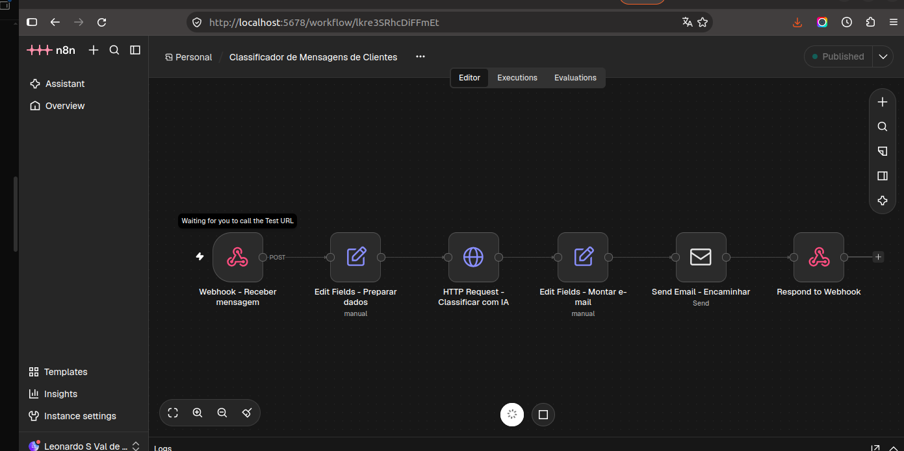

### 7.2 Execução bem-sucedida
Execução concluída com todos os nodes em verde.

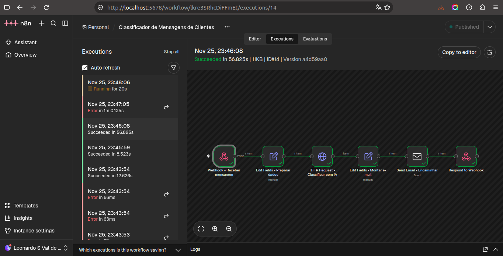

### 7.3 Configuração dos nodes

**Webhook - Receber mensagem**: método POST, caminho `mensagens`, resposta via node *Respond to Webhook*.
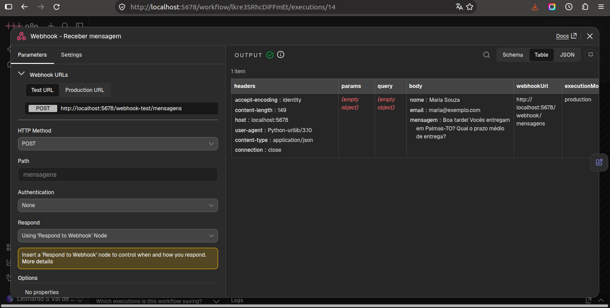

**Edit Fields - Preparar dados**: extrai `nome`, `email` e `mensagem` do corpo da requisição.
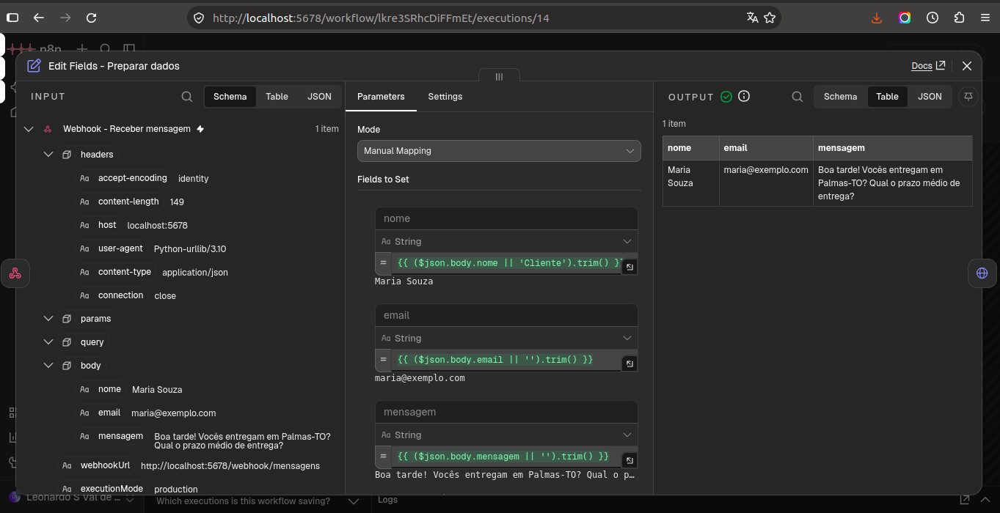

**HTTP Request - Classificar com IA**: POST para `{{ $env.API_URL }}/classificar` com corpo JSON.
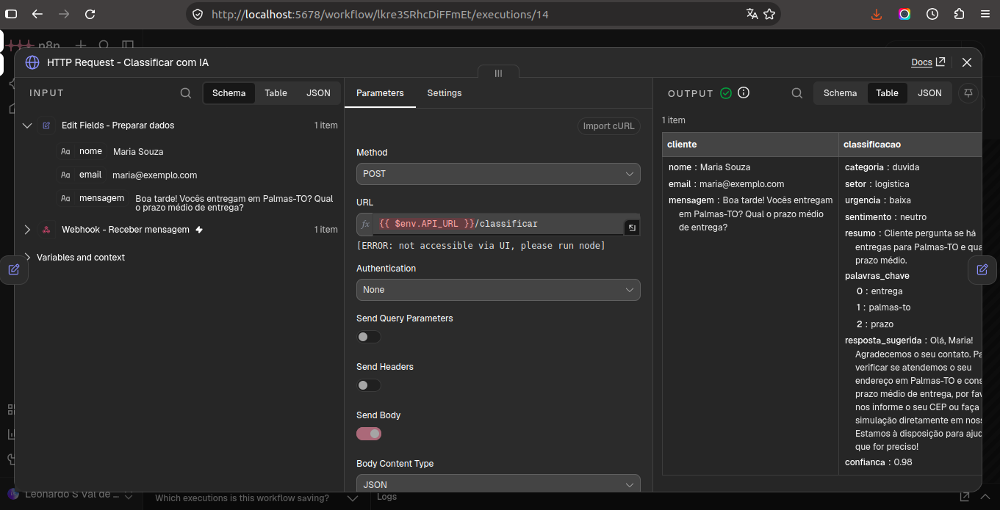

**Edit Fields - Montar e-mail**: cria `email_assunto` e `email_html` a partir da classificação.
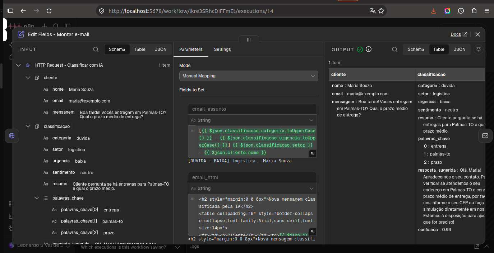

**Send Email - Encaminhar**: credencial SMTP da conta de e-mail, destino `{{ $env.EMAIL_DESTINO }}`, formato HTML.
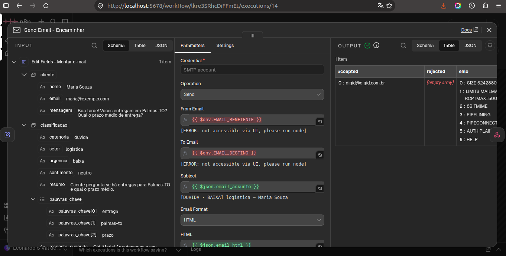

**Respond to Webhook**: devolve JSON com status e classificação.
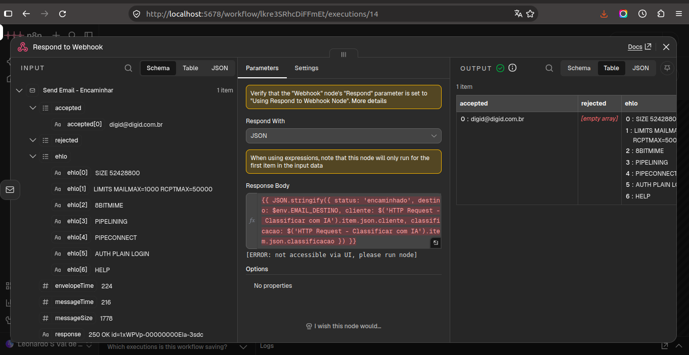

### 7.4 Resultados

Saída do HTTP Request com o JSON gerado pela IA:
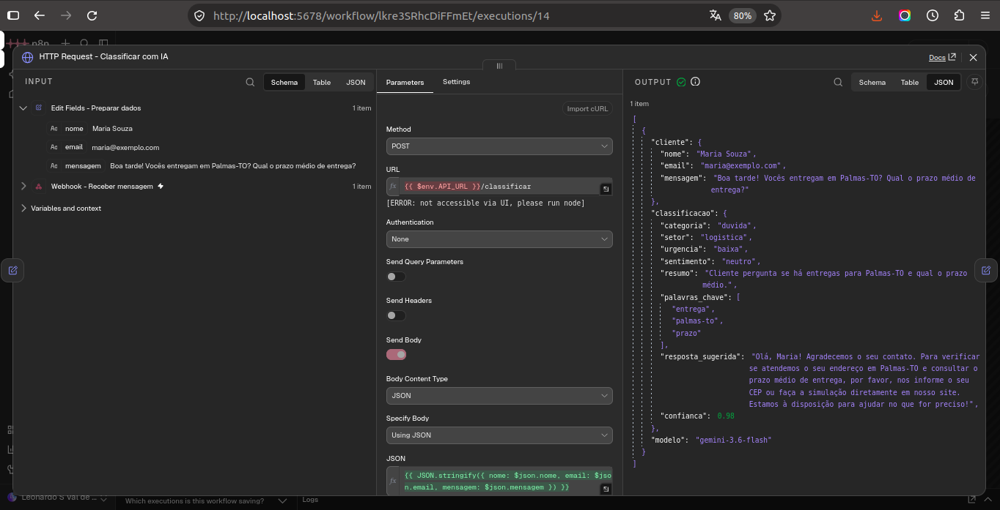

E-mail recebido na caixa de entrada do destinatário:
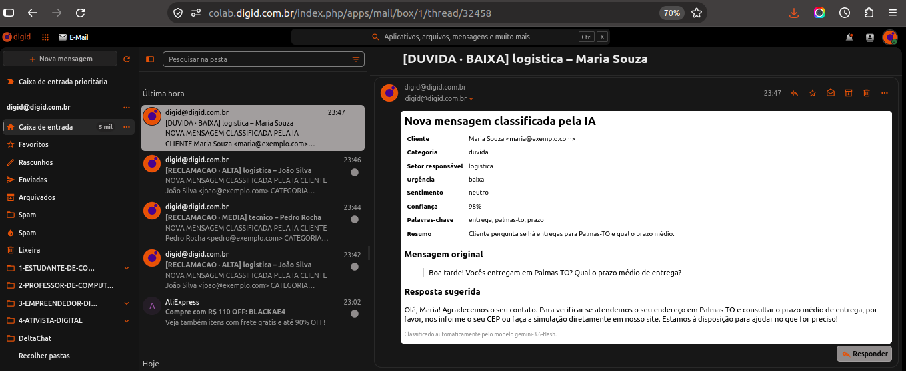

Resposta do webhook no terminal (script de exemplos):
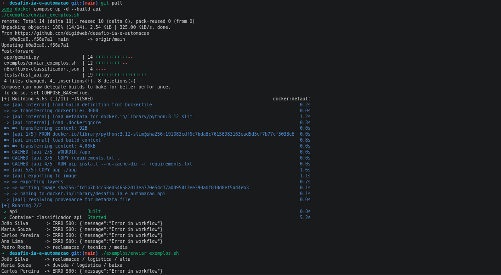
